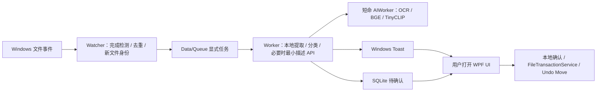

# SmartFiles 当前架构

Watcher 等；Worker 干活；UI 让我看。只有 Watcher 默认长期存在。

Watcher 不依赖 WPF、OCR、ONNX、SQLite 或网络。阻塞等事件，不作周期扫描。启动身份基线不入队，暂停期间文件不补扫。
Worker 默认 45 秒空闲退出，可配置 30–600 秒；模型子进程随父进程释放。UI 默认关闭即退出；CloseToTray 可选默认关闭。
自启仅 Watcher --startup，延迟 20 秒。通知原生系统 Toast；点击协议打开 --open-task。TTL 晚到只更新待确认，最多三次 Worker 失败后转人工。

API 仅有 JSON Chat Completions 和模型列表，没有完整文件上传能力。字段和片段有界，真实目录脱敏，OCR 足够时不附图。返回 ID 映射由本地校验，不能执行任意命令。
默认日志 50 MiB、缓存 100 MiB、模型缓存 100 MiB；历史 10000 条 / 180 天；不永久保存用户文件 embedding、全文、请求或响应副本。只保留每个模型的一份正式权重。
撤销不复制备份；只用身份校验后的 Move。活动跨卷临时数据保存恢复信息，终态清理已证明归属的数据；未知数据不擅删。

性能、实际运行限制和最终构建状态见 verification-report.md。Low Background Mode 预留，未实现定时 Scanner。
