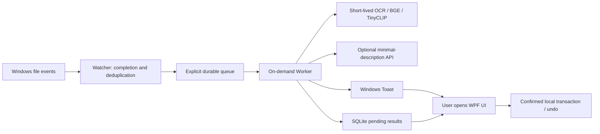

# Architecture

Watcher waits. Worker processes. The UI lets you review. Only Watcher stays running by default.

Watcher has no WPF, OCR, ONNX, SQLite, or network dependency. It blocks on events, not periodic scans. Registration records existing file identities without queuing them. Files received while paused become part of the next baseline. Recovery reads only explicitly recorded unfinished jobs.

Worker defaults to a 45-second idle timeout, configurable from 30 to 600 seconds. Models load only when needed, in a short-lived child contained by a Windows Job Object. Three consecutive worker failures send a task to manual review instead of an infinite restart loop.

UI close exits by default; tray residency is optional. Sign-in startup launches only Watcher after 20 seconds. Toast activation opens `--open-task`. Results beyond the interactive TTL update pending results without opening or focusing the UI. Low Background Mode is reserved; there is no periodic Scanner implementation.

API operations are JSON Chat Completions and model discovery. No complete-file upload endpoint exists. Text is bounded and paths are redacted. Sufficient OCR suppresses thumbnails. Validated category IDs map to local paths; AI cannot run commands or arbitrary file operations.

Logs, caches, model cache, and terminal history have retention limits. Temporary files are removed only when ownership and transaction state are known. Undo moves files back without copying backups. SQLite compaction requires substantial reusable space rather than a high-frequency timer.

New tasks and default category trees use English. Legacy task labels normalize on reading; known default categories receive English display aliases and remain addressable by their original IDs. Existing paths, filenames, keywords, and custom labels are never renamed by the language update.
